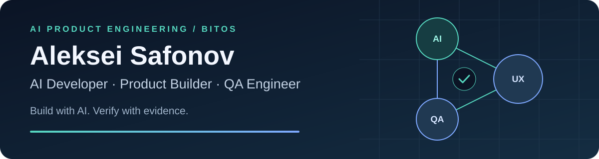
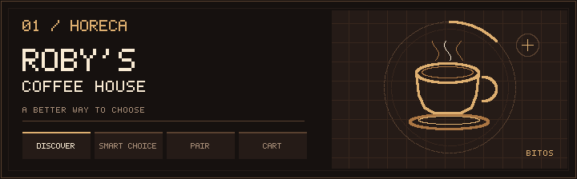
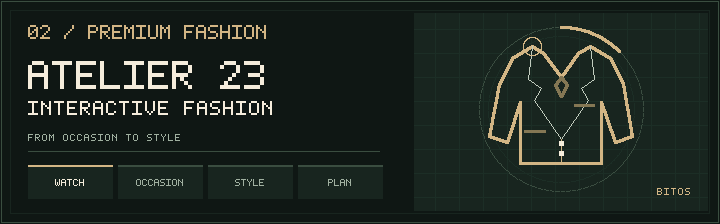
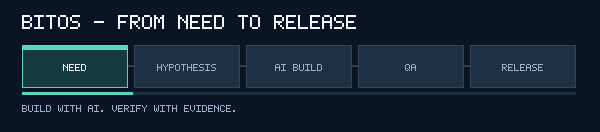

# Aleksei Safonov | AI Developer · Product Builder · QA Engineer

<p align="center"></p>

**AI-assisted web development • AI agents & automation • FinTech & Web3 reliability**

I turn business needs into working digital products — from requirements and user journeys to AI-assisted implementation, testing, and release. My commercial QA background helps me validate generated code and investigate failures rather than rely on plausible output.

[](https://github.com/safal207) [](https://t.me/Alexfox14) [](mailto:safal0645@gmail.com)

**Open to remote AI Developer / AI-assisted development, product automation, and QA opportunities.**

**Explore by interest:** [Live product demos](#ai-assisted-product-portfolio) · [AI agent verification & financial QA](#what-i-verify) · [Open-source evidence](#selected-proof) · [Contact](#contact)

<!-- ai-product-portfolio:start -->
## AI-assisted product portfolio

| Project | What it demonstrates | Explore |
|---|---|---|
| **Roby's Coffee House** | Multilingual digital storefront, Smart Choice recommendations, cart, product journeys and QA gates. | [Live demo](https://safal207.github.io/robys-coffee-house-demo/) · [Source](https://github.com/safal207/robys-coffee-house-demo) |
| **Atelier 23 × BitOS** | Independent premium-fashion concept: interactive video-led journey, personal styling and occasion-based planning. | [Live demo](https://safal207.github.io/merdo-bitos/atelier23/fashion-overlay/) · [Source](https://github.com/safal207/merdo-bitos/tree/main/atelier23/fashion-overlay) |
| **Zenit Alanya** | Independent football academy website concept: multilingual UX, player account, Supabase and interactive learning/game features. | [Live demo](https://safal207.github.io/zenit-alanya-site/) · [Source](https://github.com/safal207/zenit-alanya-site) |
| **Telegram for Codex** | Local Python/MCP integration for Telegram search, message context and reply drafting with explicit approval boundaries. Developer alpha. | [Source & setup](https://github.com/safal207/telegram-for-codex) |
| **AI PATH** | Accessible programming and QA learning resources with interactive exercises. | [Live demo](https://safal207.github.io/test-it-python/ai-path/) · [Source](https://github.com/safal207/test-it-python) |

**My role:** product concept, requirements, user journeys, directing AI-assisted implementation, reviewing code and behavior, investigating defects, and preparing releases. AI agents assist with implementation; I take responsibility for the decisions and verification within the agreed scope.

**Tools and technologies:** ChatGPT, Codex, MCP, Git/GitHub, JavaScript/TypeScript, Python, HTML/CSS, REST API, SQL, Playwright, GitHub Actions, Supabase.

### Featured product cases — from user need to working experience

#### Roby's Coffee House — HoReCa / digital storefront

<a href="https://safal207.github.io/robys-coffee-house-demo/"></a>

**Problem:** a static menu lists products but does not necessarily help a visitor decide what to order.

**Solution:** a mobile-first, multilingual storefront with Smart Choice recommendations, product pairings, cart and user journeys. The project includes TypeScript, browser regression checks and CI quality gates.

**Result:** a publicly accessible product demo and an inspectable implementation. Real conversion and revenue impact have not been established.

[Explore Roby's live demo](https://safal207.github.io/robys-coffee-house-demo/) · [Source & QA](https://github.com/safal207/robys-coffee-house-demo)

#### Atelier 23 × BitOS — Fashion / personalized customer journey

<a href="https://safal207.github.io/merdo-bitos/atelier23/fashion-overlay/"></a>

**Problem:** a premium tailoring customer may begin with an occasion or a desired look rather than a specific garment.

**Solution:** an independent mobile fashion concept with a video-led interactive journey, occasion-based choices, personal styling and preparation planning.

**Result:** an interactive prototype for exploring personalization and customer engagement. It is not an official Atelier 23 service, a confirmed client deployment or evidence of increased sales.

[Explore Atelier 23 interactive fashion](https://safal207.github.io/merdo-bitos/atelier23/fashion-overlay/) · [Source](https://github.com/safal207/merdo-bitos/tree/main/atelier23/fashion-overlay)

### BitOS — my product development approach

<p align="center"></p>

```text
Business & user needs → hypothesis → user journey → AI-assisted implementation
                     → QA & evidence → release → measure → iterate
```

I use this approach to explore digital storefronts, interactive funnels, and automation. Product concepts and demos are not claims of client adoption or proven revenue uplift; those outcomes require separate measurement.

<details>
<summary><strong>Обо мне — для русскоязычных команд</strong></summary>

AI-разработчик и QA-инженер с коммерческим опытом в FinTech. Создаю веб-продукты и интеграции с помощью AI-инструментов: исследую потребности, формулирую требования, проектирую пользовательские сценарии, управляю AI-assisted разработкой, проверяю бизнес-логику и качество результата. Развиваю методологию BitOS на стыке разработки, продуктового мышления, маркетинга и QA.

Открыт к удалённому сотрудничеству: AI Developer, Vibe Coder, автоматизация и QA. [Telegram](https://t.me/Alexfox14) · [Email](mailto:safal0645@gmail.com).

</details>
<!-- ai-product-portfolio:end -->

---

## Smart Contract QA & AI Agent Verification

## I pressure-test the moment software moves money or claims a real-world result.

**Independent smart-contract testing, AI-agent verification, agentic-payment security, and FinTech reliability engineering.**

## My mission

**Make intelligent and financial systems worthy of human trust — through verifiable actions, open research, and accessible education.**

I build open tools, reproducible experiments, and practical learning resources that help people verify what systems actually do, understand why actions were authorized, recover safely from failure, and retain meaningful human control. My goal is to turn engineering knowledge into lasting public value: safer technology, shared evidence, and opportunities for others to learn, reproduce, and improve the work.

Success is not the number of repositories I create, but the number of people and teams who can use, verify, and build upon what I share.

> When a payout, escrow release, settlement, or agent action times out, retries, races, or recovers from stale state — can you prove whether **zero, one, or an unknown number of economic effects** occurred, and block retry when the answer is unknown?

I help Web3, DeFi, FinTech, and AI-agent teams turn one high-risk transition into **bounded adversarial tests, reproducible evidence, and regression coverage before production**.

I bring **6 years 10 months of commercial manual QA in FinTech**, plus earlier SQL-engineering work in banking (2014–2018). My work spans banking, brokerage, REST APIs, WebSockets, SQL, integrations, payment reconciliation, risk, regression strategy, and failure analysis.

**Latest public interoperability:** [T-Trace/OpenPoC](https://github.com/safal207/T-Trace) independently matched **18/18 Governex `-01` checks**; Governex now links the independent reports, and the draft author confirmed named RFC 7942 Implementation Status credit in the forthcoming revision.

**2-minute evidence index:** [Evidence of Engineering Impact](EVIDENCE_OF_ENGINEERING_IMPACT.md) — independent reproduction, applied technical corrections, accepted reliability boundaries, and merged external contributions.

<!-- open-source-impact:start -->
## Open Source Impact — five flagship directions

**From research and engineering to measurable public value.** Choose a project by the problem you want to solve, not by the number of repositories.

| Flagship / entry point | Public benefit | How to participate |
|---|---|---|
| [ContractGraph-QA](https://github.com/safal207/ContractGraph-QA) — financial reliability | Help reduce duplicate, lost, or incorrectly settled value through bounded tests and reproducible evidence. | Reproduce a recovery or state-machine fixture; submit a minimal counterexample or regression test. |
| [Causal Memory Layer](https://github.com/safal207/Causal-Memory-Layer) — trustworthy AI infrastructure | Make the causal ancestry of agent actions and human approvals inspectable. | Run the documented example; test missing, stale, or inconsistent authority lineage. |
| [T-Trace / OpenPoC](https://github.com/safal207/T-Trace) — open protocols and interoperability | Make action receipts and trace claims independently checkable while keeping assurance limits explicit. | Reproduce a pinned vector; contribute a compatibility result, negative fixture, or specification review. |
| [BardoCompute](https://github.com/safal207/BardoCompute) — experimental computing research | Share testable hypotheses about transition-state execution, verification, and recovery. | Reproduce a pinned experiment, compare it with a stated baseline, or report a negative result. Research reference, not a production processor or a proven speed advantage. |
| [AI PATH](https://safal207.github.io/test-it-python/ai-path/) — accessible technology education | Lower the barrier to learning programming, QA, and responsible AI use. | Try the [Python trainer](https://safal207.github.io/test-it-python/), contribute lesson feedback in the [source repository](https://github.com/safal207/test-it-python), or explore the [FinTech QA sandbox](https://github.com/safal207/qa-fintech-api-python-course). |

Related work remains accessible in the extended technical portfolio below, including ProofPath, AgentProof, Causal Cell, RESONANCE, and independent QA research. The five directions are a navigation map, not a claim that all projects are integrated.

### Join the community — one useful contribution at a time

**[Choose your first contribution → Community Growth](COMMUNITY_GROWTH.md)** — five project entry points, existing newcomer issues, reproduction report template, and community outcome counting rules.

- **Developers and QA engineers:** follow a project's README, run one reproducible example, and share the exact version, environment, expected result, and observed result. A focused issue or regression PR is welcome.
- **Researchers and standards contributors:** reproduce an experiment independently, compare competing explanations or implementations, and publish positive or negative results with explicit limitations.
- **Learners and educators:** complete one exercise, identify a confusing explanation or failing example, and suggest a correction or accessible translation.
- **Organizations and maintainers:** propose one concrete reliability or interoperability problem using a public or synthetic example; distinguish a proposed collaboration from actual adoption.

Use the relevant repository's contribution instructions and issue tracker where enabled; otherwise [contact me](mailto:safal0645@gmail.com?subject=Open%20Source%20Impact%20contribution). Keep credentials, customer data, confidential artifacts, and personal information out of public reports. Test only within authorized environments; use the project's security-reporting route or private contact for sensitive findings. Check each repository's license before redistribution.

### Public impact scoreboard — baseline, 25 November 2026

Measure externally checkable outcomes, not repository volume. This is a selected, evidence-linked baseline, not a complete lifetime contribution count.

| Indicator | Baseline | What counts / evidence |
|---|---|---|
| Accepted external contributions | **At least 5 merged PRs** | [StreamPay #161](https://github.com/Streampay-Org/StreamPay-Contracts/pull/161), [CommitLabs #556](https://github.com/Commitlabs-Org/Commitlabs-Contracts/pull/556), [Stellar Kraal #162](https://github.com/Stellar-kraal/stellar-kraal-contract/pull/162), [TrustLayer #12](https://github.com/TrustLayer-Org/TrustLayer-Backend/pull/12), [TRACE #215](https://github.com/agentrust-io/trace-spec/pull/215). Four code/test contributions and one documentation contribution; not five production deployments. |
| Applied external technical corrections | **6 corrections in one documented review** | [x402 review author's confirmation](https://github.com/x402-foundation/x402/issues/3379#issuecomment-5731942887). Count applied corrections, not comments posted. |
| Accepted external design feedback | **1 documented example** | [LangGraph experiment author's acceptance](https://github.com/langchain-ai/langgraph/issues/7417#issuecomment-5701980916). Accepted for a future iteration; not a merged framework change. |
| Reproducible interoperability evidence | **18/18 pinned checks matched** | [T-Trace / Governex report](https://github.com/safal207/T-Trace/blob/main/docs/governex-action-receipts-v01-compatibility.md) and [external reference](https://github.com/governex/agent-action-receipts-vectors). Exact corpus only; not general conformance or adoption. |
| External reproduction and comparison | **1 documented 18-trial comparison** | [CrewAI discussion](https://github.com/crewAIInc/crewAI/issues/5802#issuecomment-5764332870). Bounded same-host fixture, not a distributed guarantee. |
| Available learning material | **40 Python lessons, 13 executable exercises, 6 projects** | [Trainer README](https://github.com/safal207/test-it-python). Content inventory, not learner outcomes. |
| Independent users, active contributors, external deployments, learner completions | **Not measured** | Count unique consenting participants or publicly attributable evidence; do not infer usage from stars, forks, downloads, visits, or test counts. |

**Measurement practice:** review monthly as a proposed cadence, record dated links and exact revisions, deduplicate contributions and reproductions, and report limitations and corrections. Track reach (stars, forks, downloads) separately from verified adoption, accepted changes, and learning outcomes. Unknown is not zero. No financial savings, learner gains, or production safety claims without supporting evidence.

[Inspect the engineering impact record](EVIDENCE_OF_ENGINEERING_IMPACT.md) · [Explore the research journal](https://safal207.github.io/RESONANCE/)

<!-- open-source-impact:end -->

<!-- recent-external-delivery:start -->
## Recent external Soroban & reliability delivery

**Public scoreboard: 4 merged upstream PRs — including 3 Soroban/Rust contract contributions — plus 1 draft Soroban/Rust contract PR awaiting an acceptance-scope decision.**

Applications are pipeline, not proof. This table counts only GitHub-verifiable delivery states.

| Status | Scope | Evidence |
|---|---|---|
| **Merged** | StreamPay contract — exact cancellation and end-time settlement across paused, bounded, and terminal paths | [PR #161](https://github.com/Streampay-Org/StreamPay-Contracts/pull/161) |
| **Merged** | CommitLabs contract — deterministic stateful lifecycle model and invariant/failure-atomicity coverage | [PR #556](https://github.com/Commitlabs-Org/Commitlabs-Contracts/pull/556) |
| **Merged** | Stellar Kraal contract — prevent same-ledger loan-ID collisions without changing the public ABI | [PR #162](https://github.com/Stellar-kraal/stellar-kraal-contract/pull/162) |
| **Merged** | TrustLayer backend — idempotent signal ingestion with replay, conflict, concurrency, and retention coverage | [PR #12](https://github.com/TrustLayer-Org/TrustLayer-Backend/pull/12) |
| **Draft — awaiting scope decision** | Stellar Game Studio contract proposal — commit-reveal dice flow and stateful mock settlement/refund accounting; 93-test workspace verification at `88c6a06` on 28 August 2026 | [PR #14](https://github.com/Bitcoindefi/Stellar-Game-Studio/pull/14) |

**Stellar Game Studio status, checked 7 October 2026:** the [maintainer's build and 93-test verification](https://github.com/Bitcoindefi/Stellar-Game-Studio/pull/14#issuecomment-5455231402) cover PR head `88c6a069dbe2088d7c83fb319ffebf12a3a9c1ce`. The [contract-only acceptance-scope request](https://github.com/Bitcoindefi/Stellar-Game-Studio/pull/14#issuecomment-5648228664) remains unanswered in the PR discussion. Against [upstream `c2174f3`](https://github.com/Bitcoindefi/Stellar-Game-Studio/commit/c2174f37979362d7788fab7d231138c723f25682), all four deployment/client gates remain unclosed: production Hub cancellation/refund compatibility, safe Hub reuse, new Dice deployment or proof that legacy sessions are drained, and Studio ABI/commit-reveal integration. Additional implementation is paused pending that scope decision; the earlier tests validate mock accounting, not production refund economics or deployment readiness.

**Current focus:** Soroban/Rust authorization boundaries, lifecycle and value-conservation invariants, failed-transition atomicity, and adversarial regression/property testing.

> Status labels describe the linked GitHub state only; they do not imply payment, endorsement, a full audit, or certification.
<!-- recent-external-delivery:end -->

```text
one critical workflow
        ↓
one economic promise
        ↓
bounded pressure test
        ↓
reproducible evidence and a clear ship / fix / stop decision
```

<!-- portable-evidence-pack:start -->
## 📦 New product — Portable Hydrated Lattice Evidence Pack

> **One ZIP. Exact inputs. Machine verdict. Human explanation. Independent replay.**

ContractGraph-QA now turns a financial or smart-contract state-machine assessment into a portable evidence package that another engineer can verify on a separate machine.

```text
contract structure
+ observed execution
+ reviewed authority / time bindings
→ PASS | FAIL | INCONCLUSIVE
→ deterministic evidence.zip
→ independent type-sensitive replay
```

The verifier checks canonical JSON and ZIP metadata, every entry hash and size, semantic replay, type drift, tampering, and an optional separately obtained SHA-256 for exact-byte integrity.

**Shipped and reviewed:** [product documentation](https://github.com/safal207/ContractGraph-QA/blob/main/docs/HYDRATED_LATTICE_EVIDENCE_PACK.md) · [merged implementation PR #97](https://github.com/safal207/ContractGraph-QA/pull/97) · [completed product scope #96](https://github.com/safal207/ContractGraph-QA/issues/96)

> Boundary: this is a reproducible proof package, not a security certificate, source-identity proof, or authorization to move money.
<!-- portable-evidence-pack:end -->

<!-- profile-offer:start -->
### 🟢 Open for paid, fixed-scope engagements

**Start with one question:**

> **What is the single transition your team cannot afford to get wrong?**

**[Email me that workflow](mailto:safal0645@gmail.com?subject=Fixed-scope%20verification%20request)** — a repository or contract link, the risky transition, and the desired deadline are enough for the first message.

I will respond with a **fit / no-fit assessment**, then propose the scope, authorization boundary, fixed quote, deliverables, and stop conditions before any execution.

Broad production access is not required. A repository, testnet, sandbox, test contract, or another explicitly authorized surface is enough.
<!-- profile-offer:end -->

---

<!-- recovery-kit:start -->
## ⚡ Free diagnostic — Ambiguous Payment Recovery Kit

> **Your provider said `accepted`. Can your workflow prove whether zero, one, or an unknown number of economic effects occurred before permitting a retry?**

### **[Run the live seven-question self-test →](https://ambiguous-payment-recovery-kit.lovable.app/?ref=github-profile&utm_source=github&utm_medium=profile&utm_campaign=ambiguous-payment-recovery)**

The kit maps the evidence boundary across:

```text
authorization
→ provider
→ external rail
→ recipient
→ customer ledger
```

| Verdict | What the evidence supports | Safe action |
|---|---|---|
| `VERIFIED` | One matching economic effect is independently observed | Finalize; do not retry |
| `SAFE_TO_RETRY` | Zero effects and a pre-effect rejection are proven | Permit a new attempt under policy |
| `UNVERIFIED` | The provider accepted, but the expected effect is absent | Do not claim success |
| `RECONCILE_REQUIRED` | An effect may have occurred or evidence disagrees | Block blind retry and reconcile |

**Public sandbox proof:**

```text
24 retry attempts
→ 1 durable reservation owner
→ 23 stale or duplicate attempts rejected
→ 1 external rail effect
→ 1 linked customer-ledger posting
→ receipt integrity: PASS
```

[Live recovery kit](https://ambiguous-payment-recovery-kit.lovable.app/?ref=github-profile&utm_source=github&utm_medium=profile&utm_campaign=ambiguous-payment-recovery) · [Executable proof and pilot lab](https://github.com/safal207/valta-pilot-lab) · [Request a fixed-scope review](mailto:safal0645@gmail.com?subject=Ambiguous%20payment%20recovery%20review)

> Boundary: this is reproducible evidence for the declared sandbox model, not a universal exactly-once guarantee, custody service, payment rail, or compliance certificate.
<!-- recovery-kit:end -->

---

## What I verify

| Search area | Practical question | Primary project |
|---|---|---|
| **Smart-contract QA and Solidity testing** | Can escrow, settlement, vesting, payout, or cancellation logic lose, duplicate, lock, or misallocate value? | [ContractGraph-QA](https://github.com/safal207/ContractGraph-QA) |
| **AI-agent verification and action receipts** | Does a valid-looking trace actually support the claimed real-world effect, or can evidence be stale, replayed, incomplete, or bypassed? | [T-Trace / OpenPoC](https://github.com/safal207/T-Trace) |
| **AI-agent authorization and payment security** | Should this exact action execute now, under this authority, scope, budget, recipient, and approval? | [ProofPath](https://github.com/safal207/ProofPath) |
| **AI-agent audit trails and causal lineage** | Why was this action allowed, and does its task, delegation, policy, or human-approval ancestry still exist? | [Causal-Memory-Layer](https://github.com/safal207/Causal-Memory-Layer) |
| **FinTech reliability and payment reconciliation** | Do provider state, external-rail effects, recipient state, customer ledger, and receipts converge to one justified recovery verdict? | [Live Recovery Kit](https://ambiguous-payment-recovery-kit.lovable.app/?ref=github-profile&utm_source=github&utm_medium=profile&utm_campaign=ambiguous-payment-recovery) · [Pilot Lab](https://github.com/safal207/valta-pilot-lab) |

---

<!-- partners:start -->
## Selected proof

This is **proof, not a logo wall**. I list completed work, independent interoperability, and merged contributions — not prospects, unanswered outreach, or implied endorsements.

| Evidence | Verified result |
|---|---|
| [Portable Hydrated Lattice Evidence Pack](https://github.com/safal207/ContractGraph-QA/blob/main/docs/HYDRATED_LATTICE_EVIDENCE_PACK.md) | **Exact inputs + machine verdict + human summary → deterministic ZIP → independent type-sensitive replay; merged after exact-head CI, Product, Portability, Finding report, and measurement-provenance validation** |
| [Cross-system payment recovery proof](https://github.com/safal207/valta-pilot-lab) | **24 concurrent retries → 1 durable owner → 23 rejected attempts → 1 external effect → 1 linked ledger posting → independently verifiable receipt** |
| [Valta Pilot Lab](https://github.com/safal207/valta-pilot-lab) | Completed and mutually signed-off Sprint 1 covering agent-payment policy enforcement, concurrent-spend behavior, and retry/idempotency exposure |
| [Governex Agent Action Receipts](https://github.com/governex/agent-action-receipts-vectors) | T-Trace/OpenPoC independently matched **18/18 pinned `-01` checks** — 16 receipt-log vectors plus 2 signed-head checks — without importing or executing the upstream verifier. Governex publicly links the reports, and the forthcoming `-01` RFC 7942 Implementation Status is confirmed to credit **Aleksei Safonov — Independent Researcher and Maintainer of T-Trace/OpenPoC**. |
| [Attenu independent vector runs](https://github.com/attenu-io/attenu-guard/blob/5bc619dd43f031cf51fc4e1f58ceb31f1da2771a/README.md) | ContractGraph-QA independently reproduced **[18/18 observer-envelope v1.1](https://github.com/safal207/ContractGraph-QA/blob/776a43cd554fd25c9f9a4a258c7818719f81cac3/proofs/attenu-envelope-v1.1-independent/README.md)** (Python) and **[20/20 Delegation Token vectors](https://github.com/safal207/ContractGraph-QA/blob/6893d0fd403f3cca3f1614aa259799250cedc005/proofs/attenu-delegation-20-independent/README.md)** (Node.js), without importing upstream runtime. Scores apply only to frozen corpora at these pins. Delegation: draft-01 steps 1–5, single-signer HS256 public test keys; DPoP, Token Status List and actual-action authorization **NOT_RUN**; production Ed25519 and audience policy out of scope. No general conformance, capture/verifier completeness, runtime correctness, audit, certification or endorsement claim. |
| [Asqav SDK independent-run record](https://github.com/jagmarques/asqav-sdk/blob/26b994b6881d993778feab74d620ef11eb2a9216/verifier/independent-runs.json#L6-L19) | T-Trace/OpenPoC independently recomputed **3/3 selected Asqav omission/recovery vectors** without running Asqav verifier code. The upstream record links [T-Trace PR #38](https://github.com/safal207/T-Trace/pull/38) and the pinned source commit. Bounded vector evidence, not full-profile conformance or endorsement. |
| [AgenTrust trace-spec](https://github.com/agentrust-io/trace-spec) | Verification-outcome guidance was reviewed and merged in [PR #215](https://github.com/agentrust-io/trace-spec/pull/215) |

**Standards contribution:** technical feedback from the T-Trace/OpenPoC review informed the new repeated-`step_id`, signed-`seq` gap/reuse, and external signed-head assertion vectors. This is independent interoperability and threat-boundary work — not co-authorship, IETF adoption, or endorsement.

**Governex original `-00` evidence:**  
[13/13 report](https://github.com/safal207/T-Trace/blob/main/docs/governex-action-receipts-compatibility.md) · [Verifier source](https://github.com/safal207/T-Trace/blob/main/openpoc/action_receipt_compat.py) · [Pinned workflow](https://github.com/safal207/T-Trace/actions/workflows/governex-action-receipts.yml)

**Governex `-01` evidence:**  
[18/18 report](https://github.com/safal207/T-Trace/blob/main/docs/governex-action-receipts-v01-compatibility.md) · [Capture-side review](https://github.com/safal207/T-Trace/blob/main/docs/governex-action-receipts-v01-capture-review.md) · [Verifier source](https://github.com/safal207/T-Trace/blob/main/openpoc/action_receipt_compat_v01.py) · [Pinned workflow](https://github.com/safal207/T-Trace/actions/workflows/governex-action-receipts-v01.yml) · [PR #23](https://github.com/safal207/T-Trace/pull/23)

**Boundary:** these are different kinds of evidence. None implies blanket corporate partnership, adoption, formal standard status, or endorsement.
<!-- partners:end -->

---

<a id="paid-review"></a>
<!-- smart-contract-services:start -->
## 🛡️ First Risk Boundary Review

The first engagement is deliberately small: **one critical economic workflow**, a bounded set of adversarial cases, and evidence another engineer can reproduce.

The transformation is simple:

```text
“we think this path is safe”
              ↓
exact states, invariants, failures, and evidence
              ↓
a defensible engineering decision
```

### Best-fit workflows

- escrow creation, funding, release, dispute, refund, and auto-settlement;
- streaming-payment cancellation and exact end-time settlement;
- vesting, revocation, payouts, fees, revenue sharing, and value conservation;
- wallets, DeFi/FinTech contracts, and agentic-payment systems;
- contract ↔ API/backend ↔ ledger/audit consistency;
- Solidity/Foundry and other stacks agreed during scoping.

### Questions I pressure-test

| Risk area | The question |
|---|---|
| Value conservation | Can any path create, lose, strand, duplicate, or misallocate value? |
| Lifecycle safety | Does every value-holding state retain a valid path to settlement, refund, or recovery? |
| Timing boundaries | What happens exactly at cancellation, expiry, vesting, dispute, or end-time boundaries? |
| Retry and idempotency | Can an ambiguous response or repeated request commit twice? |
| Concurrency and ordering | Can two individually valid calls produce one invalid economic outcome? |
| Authorization | Can stale, revoked, reused, or mismatched authority still trigger an effect? |
| Cross-system consistency | Do contract state, API response, wallet, ledger, balances, and audit evidence converge? |
| Evidence integrity | Can a valid-looking trace omit, replay, mutate, or falsely claim the real-world effect? |

### What the client receives

1. A concise state-transition and risk map.
2. Reproducible tests and exact traces for confirmed issues.
3. Severity and business-impact analysis.
4. Minimal remediation guidance.
5. Regression, invariant, negative, boundary, or property-based coverage.
6. A short engineering report suitable for review and handoff.
7. An optional fix or pull request when separately agreed.

### Engagement boundary

- one critical workflow first, not an open-ended audit;
- scope, fee, authorization, delivery window, and stop conditions agreed before execution;
- repository, testnet, sandbox, or another explicitly authorized surface;
- no broad production access required;
- fully asynchronous, written collaboration is available;
- no testing without explicit authorization.

Recent scopes include escrow lifecycle safety, value conservation, dispute/release ordering, concurrent spending, duplicate/retry exposure, cancellation, and exact end-time settlement.

> Independent QA and adversarial verification reduce uncertainty within an agreed scope. They are not a guarantee of zero vulnerabilities or formal certification.

**[Request a fixed-scope review](mailto:safal0645@gmail.com?subject=Fixed-scope%20verification%20request)**
<!-- smart-contract-services:end -->

---

## Frequently asked questions

### What is smart-contract QA?

Smart-contract QA verifies whether allowed sequences of actors, calls, values, timestamps, retries, and concurrent transactions can violate a business or security invariant. It complements code review by testing reachable economic behavior and producing reproducible evidence.

### What is AI-agent verification?

AI-agent verification checks whether a specific action or claimed outcome is supported by current authority, exact intent, policy, causal lineage, action receipts, and independently inspectable evidence. Authentication alone does not prove that an action was appropriate or that its real-world effect occurred.

### What is agentic-payment verification?

Agentic-payment verification tests whether an AI-initiated payment remains bounded by recipient scope, asset rules, budgets, approvals, replay protection, idempotency, reconciliation, and auditable outcome evidence.

### Do you perform unrestricted production testing?

No. Testing stays inside an explicitly authorized repository, testnet, sandbox, test contract, API surface, or other agreed boundary. Public code or a public endpoint is not treated as authorization.

### What do you need for the first assessment?

A repository or contract link, chain and tooling, the highest-risk transition, current test status, and desired deadline. The first useful scope is usually one critical workflow rather than a broad open-ended audit.

---

## Other ways to enter the work

- **Need to diagnose an ambiguous payment retry?** Start with the [live seven-question Recovery Kit](https://ambiguous-payment-recovery-kit.lovable.app/?ref=github-profile&utm_source=github&utm_medium=profile&utm_campaign=ambiguous-payment-recovery).
- **Need a reproducible method for financial state transitions?** Start with [ContractGraph-QA](https://github.com/safal207/ContractGraph-QA).
- **Need independent action-receipt or evidence verification?** Start with [T-Trace / OpenPoC](https://github.com/safal207/T-Trace).
- **Need a pre-execution control layer for AI-agent actions?** Start with [ProofPath](https://github.com/safal207/ProofPath).
- **Need causal lineage and approval evidence for agent traces?** Start with [Causal-Memory-Layer](https://github.com/safal207/Causal-Memory-Layer).
- **Want the readable research and market-dialogue layer?** Open [RESONANCE](https://safal207.github.io/RESONANCE/).

<details>
<summary><strong>Extended technical portfolio and research directions</strong></summary>

### [ContractGraph-QA](https://github.com/safal207/ContractGraph-QA)

Independent QA framework for stateful financial and contract workflows.

```text
actor → action → state transition → invariant → reproducible evidence
```

Use it to model economic promises, pressure-test failure paths, and deliver deterministic evidence ZIPs that another engineer can independently replay.

### [T-Trace / OpenPoC](https://github.com/safal207/T-Trace)

Open protocol and executable fixtures for acknowledged state transitions, action receipts, deterministic replay, and assurance boundaries.

```text
valid presented trace ≠ proof that every real-world effect was captured
```

**External validation:** independently matched Governex action-receipt suites at **13/13 (`-00`)** and **18/18 (`-01`)**; Governex publicly links the reports, and named T-Trace/OpenPoC credit is confirmed for the forthcoming RFC 7942 Implementation Status section.

### [ProofPath](https://github.com/safal207/ProofPath)

Pre-execution gateway for high-risk AI-agent and API actions.

```text
valid credential ≠ valid action ≠ valid scope ≠ valid approval
```

Best reviewer entry point: [Reviewer First Screen](https://github.com/safal207/ProofPath/blob/main/docs/REVIEWER_FIRST_SCREEN.md)

### [Causal-Memory-Layer](https://github.com/safal207/Causal-Memory-Layer)

Causal audit layer for AI-agent action traces, parent authority, approval lineage, and reviewer evidence.

### [RESONANCE](https://safal207.github.io/RESONANCE/)

Evidence-first journal connecting technical artifacts to readable stories, open questions, and product signals.

```text
research signal → evidence → readable story → market question → product signal
```

### [Kairos Gate for X-Cell](https://github.com/safal207/Kairos-Gate-for-X-Cell)

Frontier research on evidence and governance boundaries for agentic biology. Computational and documentary only; it does not authorize experiments, treatment, or clinical decisions.

</details>

---

## How I work

- **Evidence over confidence.** A convincing claim is not a substitute for a reproducible result.
- **Root cause over symptom.** I separate product defects, contract gaps, deployment failures, and evidence limitations.
- **Exact scope before execution.** Risk, authorization, deliverables, and stop conditions are agreed first.
- **RED → fix → GREEN.** A result is not closed until the failure is reproduced and the remediation is verified.
- **Written, inspectable collaboration.** Decisions and evidence remain reviewable after the conversation ends.

---

## Background

I am a senior QA engineer, AI-product builder, and independent researcher focused on high-stakes systems where correctness depends on more than a successful HTTP response or a passing happy-path test.

My FinTech background includes banking, brokerage, API and integration testing, SQL, WebSockets, risk and reporting systems, regression prioritization, and quality-process design.

My current thesis is simple:

> AI models may propose possibilities. Evidence determines what is supported. Authorized humans determine what may proceed.

---

<!-- solvery-mentoring:start -->
## Ментор по QA и применению ИИ — Алексей Сафонов

Помогаю QA-инженерам и разработчикам разбирать рабочие задачи: тестирование REST API в Postman, SQL, тест-дизайн, подготовка к QA-собеседованию и проверка кода и тестов, созданных ИИ.

Если подписка на ИИ уже есть, а уверенности в результате пока нет, можно начать с одной небольшой задачи. Вместе уточним цель, подготовим контекст и определим, как проверить решение. На занятиях можно задавать базовые вопросы и разбираться в своём темпе.

**[Менторство с Алексеем Сафоновым на Solvery](https://solvery.io/ru/mentor/5295)** — форматы занятий, проекты, отзывы и заявка на бесплатное 15-минутное знакомство.
<!-- solvery-mentoring:end -->

---

## Follow and share the work

- [Ambiguous Payment Recovery Kit](https://ambiguous-payment-recovery-kit.lovable.app/?ref=github-profile&utm_source=github&utm_medium=profile&utm_campaign=ambiguous-payment-recovery) — live self-test, proof card, and machine-readable sandbox result.
- [RESONANCE](https://safal207.github.io/RESONANCE/) — evidence-first articles, verified reports, open problems, and market questions.
- [GitHub @safal207](https://github.com/safal207) — executable fixtures, tests, protocols, and public verification trails.
- [Brand, SEO & SMM kit](BRAND_SEO_SMM.md) — canonical bios, project one-liners, content pillars, and ready-to-use post formats.

## Contact

**Free recovery self-test:** [open the live kit](https://ambiguous-payment-recovery-kit.lovable.app/?ref=github-profile&utm_source=github&utm_medium=profile&utm_campaign=ambiguous-payment-recovery)  
**Paid review:** [send one high-risk workflow](mailto:safal0645@gmail.com?subject=Fixed-scope%20verification%20request)  
**Research, standards, grants, or collaboration:** [safal0645@gmail.com](mailto:safal0645@gmail.com)  
**Telegram:** [@Alexfox14](https://t.me/Alexfox14)  
**GitHub:** [@safal207](https://github.com/safal207)

```text
Build calmly. Pressure-test the boundary. Keep the evidence.
```
